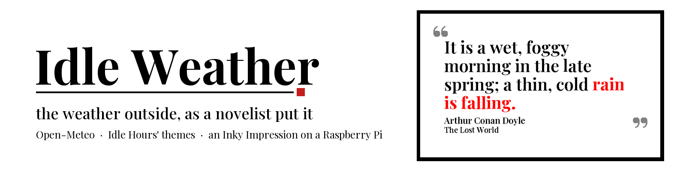

[](https://github.com/gkoch02/IdleWeather/actions/workflows/ci.yml)
[](https://github.com/gkoch02/IdleWeather/actions/workflows/github-code-scanning/codeql)
[](pyproject.toml)
[](https://www.raspberrypi.com)
[](https://github.com/gkoch02/IdleHours)
[](LICENSE)

Idle Weather is [Idle Hours](https://github.com/gkoch02/IdleHours) for the sky outside: it reads the current weather from Open-Meteo and shows a sentence from a public-domain novel that describes it, with the weather phrase picked out in bold. It renders through Idle Hours' themes onto the same 800×480 Inky Impression Spectra 6 panel.


## How it works

1. **Mine.** [`mine.py`](idle_weather/mine.py) reads Project Gutenberg books paragraph by paragraph and looks for weather phrases ([`phrases.py`](idle_weather/phrases.py)): "the rain was falling", "a hard frost", "the wind howled", not bare keywords. It skips verse, names ("Mrs. Gale"), similes ("like a flash of lightning") and other figures of speech. Each hit is cut into a display excerpt by Idle Hours' cleaner and scored by its quality filter, plus a bonus for other weather words and outdoor scenery and a penalty for bare-noun matches.
2. **Review.** The best candidates for each condition were read one by one and accepted or rejected (figurative, passing mention, hypothetical, weather already over, wrong condition, offensive, fragment). The verdicts live in [`curation.json`](idle_weather/assets/curation.json); see [`docs/curation.md`](docs/curation.md).
3. **Bake.** [`bake.py`](idle_weather/bake.py) ships only accepted quotes, at most six per book per condition, into [`weather_quotes.jsonl`](idle_weather/assets/weather_quotes.jsonl).
4. **Observe.** [`weather.py`](idle_weather/weather.py) asks Open-Meteo for the WMO weather code, temperature, wind and day/night, and caches the last good reading so a network outage or restart still knows the weather for three hours.
5. **Pick.** [`conditions.py`](idle_weather/conditions.py) maps the observation to an ordered list of conditions, the real weather first and close neighbours after it (heavy rain may borrow from rain, never from sunshine). [`pick.py`](idle_weather/pick.py) draws a quote not shown in the last 30 days, avoiding the author shown just before.
6. **Render and display.** [`render.py`](idle_weather/render.py) hands the quote to Idle Hours' renderer in a subprocess, and Idle Hours' `display_inky` pushes it to the panel.

The conditions are thunder, snow, sleet, downpour, rain, drizzle, fog, wind, clouds, sunshine, heat, frost and night_sky (a clear night).

## Install

Idle Weather depends on Idle Hours (pinned to a commit in [`pyproject.toml`](pyproject.toml)) for the renderer, themes, fonts and appliance plumbing.

```bash
python3 -m venv .venv
.venv/bin/pip install -e ".[dev]"      # add [pi] on the Raspberry Pi for the Inky stack
```

On a Raspberry Pi, follow Idle Hours' [Pi setup guide](https://github.com/gkoch02/IdleHours/blob/main/docs/pi_setup_inky_impression.md) for SPI/I2C and the GPIO packages, then install this package into the venv with `.[pi]`.

## Use

```bash
idle-weather now --latitude 51.48 --longitude 0.0      # current weather, its conditions, a sample quote
idle-weather render --condition fog --theme saloon --output /tmp/fog.png
idle-weather run --config config.toml                  # the appliance loop
idle-weather run --config config.toml --once           # one tick, then exit
```

Copy [`config.toml.example`](config.toml.example) and set your latitude and longitude. The loop repaints when the condition changes and otherwise every `rotate_minutes` (default 30), checks the weather every `weather_minutes` (default 10), and paints Idle Hours' sleep frame once on entering quiet hours. `theme = "random"` shuffles without repeats through Idle Hours' random rotation, minus the themes whose time reads as a clock: a clock face, a "2 PM" stamp, a label reading HOUR. Idle Hours lists every theme that draws the time (`TIME_SURFACE_THEMES`, kept accurate by its tests); `DECORATIVE_TIME_THEMES` in [`render.py`](idle_weather/render.py) lets back in the ones where the hour is decoration, such as a tarot numeral or an exit number. You can still name an excluded theme explicitly; the loop logs a warning when you do. Any setting can be given as a flag instead.

State lives in `state_dir`: `state.json` (last condition, theme bag), `history.jsonl` (the anti-repeat ledger) and `weather.json` (the last good reading).

### systemd

[`ops/idle-weather.service.example`](ops/idle-weather.service.example) runs the loop as a `Type=notify` service with a watchdog, state under `/var/lib/idle-weather`, and the same sandboxing as Idle Hours. A configuration error exits 42, which the unit treats as do-not-restart.

## Rebuilding the corpus

The books are the Gutenberg texts Idle Hours already caches; their ids are in [`corpus/books.txt`](corpus/books.txt).

```bash
idle-weather mine --books ../Idle-Hours/data/gutenberg         # or: --book-list corpus/books.txt --fetch --books data/gutenberg
idle-weather bake --queue output/review-queue.jsonl            # bake, and list unreviewed top candidates
```

Review the queue, record verdicts in `curation.json`, and bake again. Keys are `source_id:paragraph:offset`, so they stay stable as long as the paragraph splitting in `mine.py` does.

## Testing

```bash
pytest
ruff check .
```

The database tests check that every shipped quote was accepted in review, that every condition has a pool, and that Idle Hours' renderer can find and highlight every phrase.

CI runs the suite twice: `test` against the Idle Hours commit pinned in `pyproject.toml` (required), and `idle-hours-main` against Idle Hours' `main` (advisory, also daily). A red `idle-hours-main` means the next pin bump will break something; fix it before bumping. On the Idle Hours side, `tests/test_downstream_contract.py` lists the names Idle Weather imports, so a breaking change usually fails there first. Import something new from Idle Hours, and add it to that list.

## Known limits

- A handful of Idle Hours' themes show the time as a clock (vhs, platform, cardcatalog, bakelite, reactornight, synoptic, and the diags debug theme), so `random` leaves them out. A theme that starts drawing the time in a new Idle Hours release also stays out until it is added to `DECORATIVE_TIME_THEMES` after a look.
- A few themes print "Idle Hours" as a maker's mark (astrarium's masthead, circuit's silkscreen, sampler's quiet-hours frame). They stay in the rotation.
- Titles come from Gutenberg headers as they are, subtitles included.

## License

MIT — see [LICENSE](LICENSE). The quotes are from Project Gutenberg texts in the public domain in the United States; the themes and fonts are Idle Hours', under its own licence.
